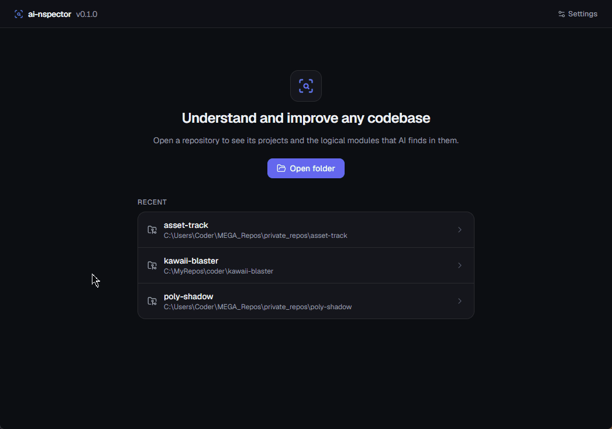

# AI-nspector


An AI-powered code inspector for desktop. Use it on your own repository or to explore a new one. More and more code is AI-generated, and this app helps you see what is in it.

Open a repository. The app finds its projects, asks an LLM to split a project into logical modules, and lets you read the files of each module.



## Why

Tools exist that explain a repository (DeepWiki, Sourcegraph, Greptile) and tools that measure code health (CodeScene, SonarQube). Few tools judge over-engineering and AI-generated "slop". That is the long-term goal of this project. The MVP builds the base: a stable, cached map of a repository.

## How it works

```
Repo  →  Project  →  Module  →  File
```

| Level | Source | Notes |
|-------|--------|-------|
| **Repo** | The folder you open | Can hold several independent projects. |
| **Project** | Manifest files (`package.json`, `.csproj`, `pyproject.toml`, `Cargo.toml`, `go.mod`, `pom.xml`, ...) | No AI. Fast, free, same result every run. |
| **Module** | LLM | The LLM sees only structure: file list, imports and top-level symbols. It does not see source code bodies. |
| **File** | Source file | Read-only view with syntax highlighting. "Open in editor" opens VS Code. |

- Module analysis supports **Python**, **C#** and **TypeScript / JavaScript**.
- Every file belongs to at least one module. Files the LLM leaves out go to an "Unassigned" module.
- Results are cached in `<repo>/.ainspector/` (git-ignored automatically). The cache key is the git commit, plus a fingerprint of local changes. When the repo changes, the app shows an **Outdated** badge. It does not regenerate on its own.

### Privacy

Module analysis sends structure only, never source code. The repo overview sends the text of the documentation files that you select. Do not select files that hold secrets or internal URLs. When a repo has no documentation, you can confirm an overview inferred from the structure: file paths, manifest files and module names. No source code is sent.

Any OpenAI-compatible endpoint works. Use a local model (for example Ollama) if your code must not leave your machine. The API key is stored in the OS credential store (Windows Credential Manager, or the Secret Service on Linux). The key is never written to the repo.

## Tech stack

[Tauri 2](https://tauri.app/) (Rust backend), React, TypeScript, Vite, Tailwind CSS, shadcn/ui, [Shiki](https://shiki.style/), tree-sitter.

## Build and run

### Prerequisites (all platforms)

- [Node.js](https://nodejs.org/) 20 or newer
- [Rust](https://rustup.rs/) (stable, 2024 edition support)
- `git` on the `PATH` (the app uses it for the cache key)
- Optional: [VS Code](https://code.visualstudio.com/) with the `code` command on the `PATH`, for "Open in editor"

### Windows

1. Install the **Visual Studio Build Tools** with the "Desktop development with C++" workload.
2. Install WebView2. Windows 11 has it already. For Windows 10, get the [Evergreen runtime](https://developer.microsoft.com/microsoft-edge/webview2/).
3. Install Rust with the MSVC toolchain (`rustup default stable-msvc`).
4. Then run:

```powershell
npm install
npm run tauri dev      # development, with hot reload
npm run tauri build    # release build: installer in src-tauri\target\release\bundle\nsis
```

### Linux (Debian / Ubuntu)

```sh
sudo apt install build-essential libwebkit2gtk-4.1-dev libxdo-dev libssl-dev \
  libayatana-appindicator3-dev librsvg2-dev libsecret-1-dev gnome-keyring

npm install
npm run tauri dev      # development, with hot reload
npm run tauri build    # release build: .deb and AppImage in src-tauri/target/release/bundle/
```

For other distributions, see the [Tauri prerequisites](https://tauri.app/start/prerequisites/). You need a Secret Service provider (`gnome-keyring` or KWallet). Without one, the app cannot save the API key.

> The first build compiles all Rust dependencies. A cold `tauri build` can take more than 10 minutes.
> Build on the target platform. Cross-building is not supported.

## Use

1. Open **Settings**. Enter the base URL, the model name and the API key. Press **Test connection**.
   - OpenRouter: `https://openrouter.ai/api/v1`
   - Ollama: `http://localhost:11434/v1` (no key needed)
2. Open a repository folder. The app lists the detected projects.
3. Select a project, then press **Generate modules**. You can cancel while it runs.
4. Select a module card, then select a file to read it.

5. Optional: press **Overview**, select the documentation files, then press **Generate**. The app writes `brief.md` and `overview.md` to `<repo>/.ainspector/`. A new run overwrites them.

The breadcrumb at the top (`repo › project › module`) has a dropdown on each level to switch between siblings.

## Test

```sh
cd src-tauri && cargo test --lib    # Rust unit tests
npx tsc --noEmit                    # type check the frontend
```

## Known limits

- The prompt budget is fixed at about 100,000 tokens. A very large project gives an error. Batch splitting is not built yet.
- TypeScript path aliases (for example `@/`) look like external packages, so those imports are missing from the import graph.
- "Open in editor" works only with VS Code. If it is not found, the app shows the file in the file manager.
- Over-engineering and AI-slop detection are planned. They are not built yet.

## License

MIT © [koder0x](https://github.com/gsscoder)
